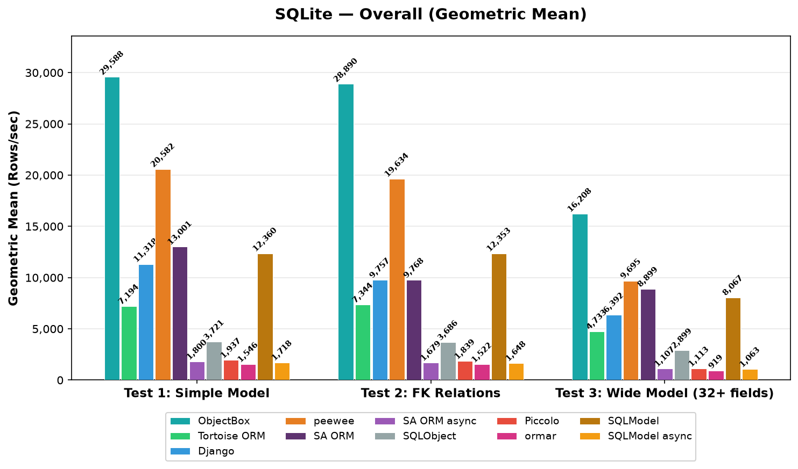
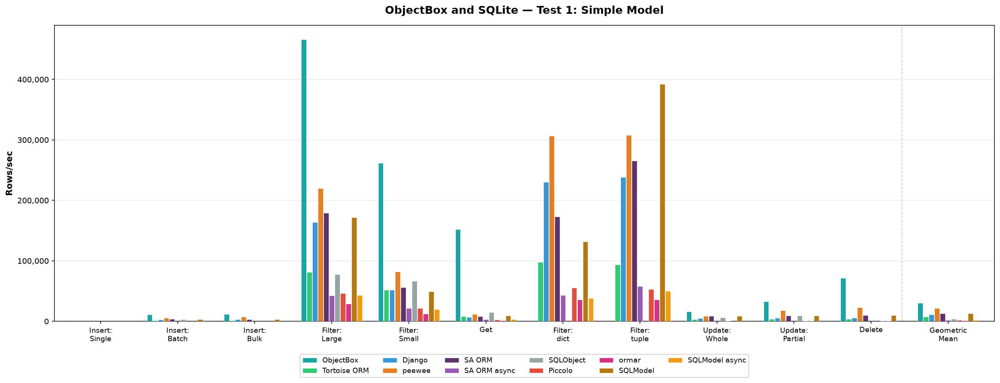
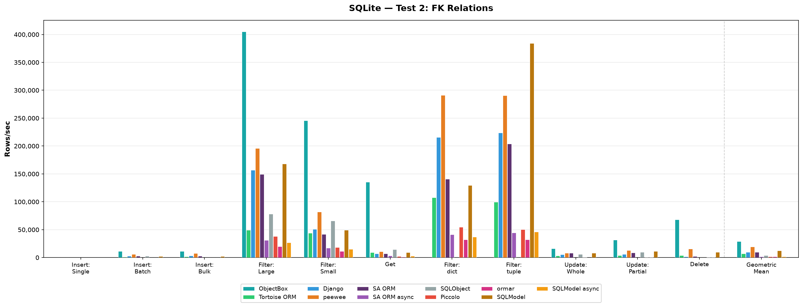
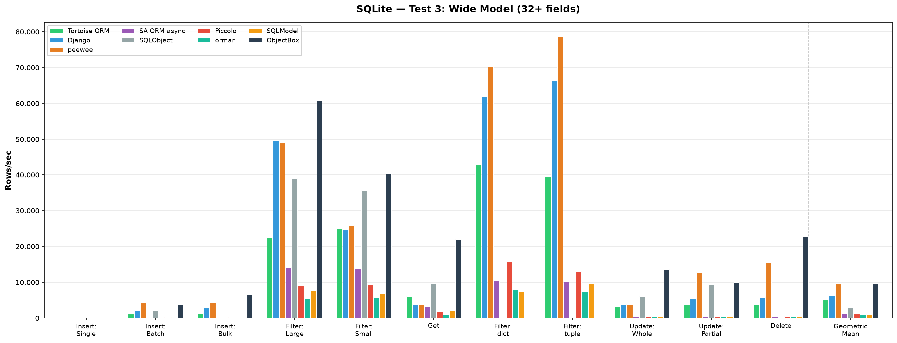
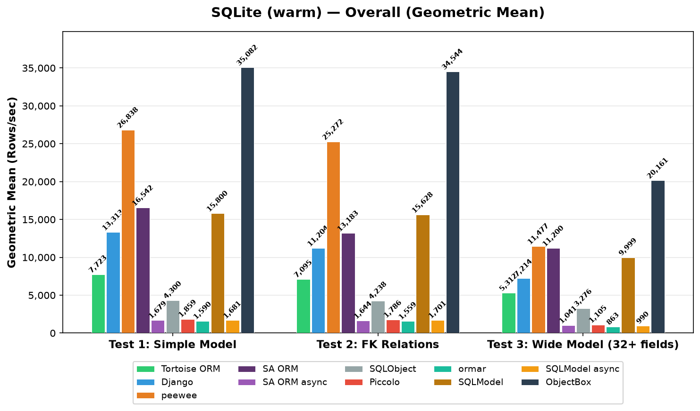
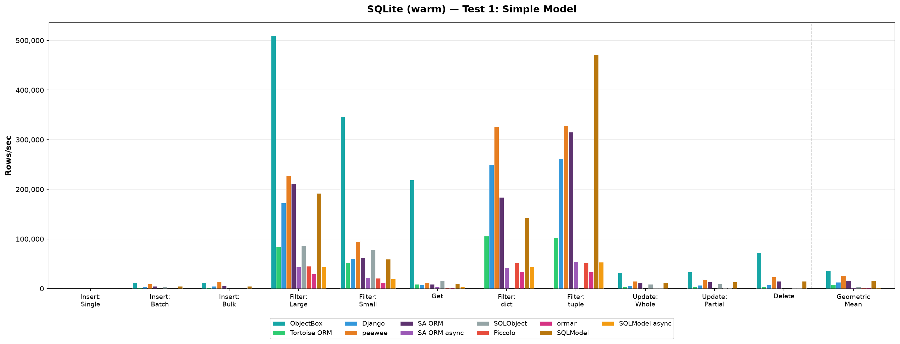
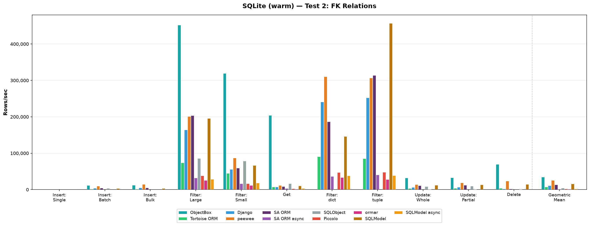
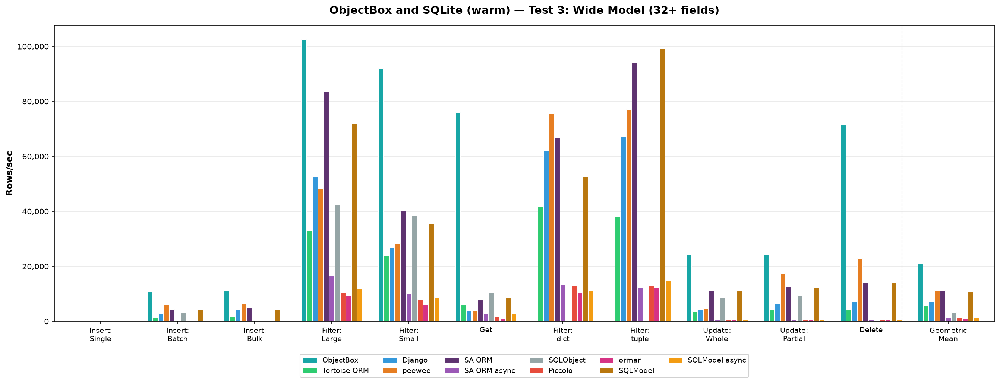

# ORM Benchmarks

Comprehensive performance benchmarks comparing popular Python ORMs across PostgreSQL, MySQL, and SQLite.

**Tested ORMs:**

| ORM | Type | PostgreSQL | MySQL | SQLite |
|-----|------|:---:|:---:|:---:|
| [Tortoise ORM](https://github.com/tortoise/tortoise-orm) | async | asyncpg | asyncmy | aiosqlite |
| [Django](https://www.djangoproject.com/) | sync | psycopg2 | mysqlclient | sqlite3 |
| [peewee](https://github.com/coleifer/peewee) | sync | psycopg2 | pymysql | sqlite3 |
| [SQLAlchemy ORM](http://www.sqlalchemy.org/) | sync | psycopg2 | mysqlclient | sqlite3 |
| [SQLAlchemy ORM (async)](http://www.sqlalchemy.org/) | async | asyncpg | aiomysql | aiosqlite |
| [SQLObject](https://github.com/sqlobject/sqlobject) | sync | psycopg2 | mysqlclient | sqlite3 |
| [Piccolo](https://github.com/piccolo-orm/piccolo) | async | asyncpg | — | aiosqlite |
| [ormar](https://github.com/collerek/ormar) | async | asyncpg | aiomysql | aiosqlite |
| [SQLModel](https://github.com/tiangolo/sqlmodel) | sync | psycopg2 | mysqlclient | sqlite3 |
| [SQLModel (async)](https://github.com/tiangolo/sqlmodel) | async | asyncpg | aiomysql | aiosqlite |
| [ObjectBox](https://github.com/objectbox/objectbox-python) | sync | — | — | embedded (own storage engine) |

> **Environment:** Python 3.14, macOS (Apple Silicon), 100 iterations per operation.
> Piccolo does not support MySQL.
> Sync SQLAlchemy ("SA ORM") and sync SQLModel are only in the SQLite results so far; the PostgreSQL/MySQL runs predate them, and their "SQLModel" chart labels refer to SQLModel async.
> ObjectBox is an embedded object database, not an ORM on top of SQL, so it is only compared in the SQLite runs. It uses the unreleased 5.0.0b1 beta with its experimental FlatBuffers codegen for writes and reads enabled (`OBX_CODEGEN=0` disables it). Differences to the SQL ORMs: Test 2 uses plain indexed ids (the Python binding has no relations), Test 3 stores decimals as strings, JSON as JSON strings (like the SQL ORMs store it as text) and leaves "nullable" columns unset (no NULL support), Filter: dict/tuple are not supported (no projection API), and Update: Partial writes the whole object. Its geometric mean covers 9 operations.

## Operations

| Code | Operation | Description |
|------|-----------|-------------|
| A | Insert: Single | Insert one row at a time |
| B | Insert: Batch | Insert many rows in a single transaction |
| C | Insert: Bulk | Use bulk insert operations |
| D | Filter: Large | Fetch a large result set |
| E | Filter: Small | Fetch limit 20 with random offset |
| F | Get | Fetch a single row by primary key |
| G | Filter: dict | Fetch large result set as dicts |
| H | Filter: tuple | Fetch large result set as tuples |
| I | Update: Whole | Update all fields of a row |
| J | Update: Partial | Update a single field |
| K | Delete | Delete a single row |

Only persisting is timed: the insert operations create the unsaved objects before the timer starts, and the update operations choose the new values before it, so creating objects (including field defaults) and generating test data don't count. SQLObject inserts the row when it creates the object, so for SQLObject only the field values are prepared; peewee's bulk insert prepares row tuples and applies defaults while inserting. Right before the timer starts, each test runs `gc.collect()` and `gc.freeze()`, so garbage from the preparation isn't collected while timed. The PostgreSQL/MySQL results predate these changes and include creating the objects.

## Test Models

**Test 1 — Simple model** (4 fields): `id`, `timestamp`, `level` (indexed), `text` (indexed)

**Test 2 — FK relations**: Same as Test 1, plus self-referential foreign key, reverse FK, and M2M relation

**Test 3 — Wide model** (32+ fields): Same as Test 1, plus 4 sets of 8 typed columns (float, smallint, int, bigint, char, text, decimal, json) — 2 with defaults, 2 nullable

---

## Results: PostgreSQL 17

PostgreSQL 17 in Docker. Driver: `asyncpg` for async ORMs, `psycopg2` for sync ORMs.

### Overview


### Test 1: Simple Model (4 fields)


| Operation | Django | peewee | SA ORM async | SQLObject | Tortoise ORM | Piccolo | ormar | SQLModel async | Best |
|-----------|--------|--------|--------------|-----------|--------------|---------|-------|----------|------|
| Insert: Single | 776 | 651 | 584 | 699 | **3,455** | 3,240 | 283 | 540 | Tortoise ORM |
| Insert: Batch | 2,069 | 2,418 | 1,154 | 1,575 | **14,033** | 12,138 | 1,048 | 1,081 | Tortoise ORM |
| Insert: Bulk | 5,224 | 5,009 | 1,264 | — | **18,807** | 18,060 | 1,178 | 1,079 | Tortoise ORM |
| Filter: Large | 57,451 | 62,009 | 32,318 | 50,694 | 143,810 | **147,031** | 19,735 | 32,389 | Piccolo |
| Filter: Small | 19,491 | 18,066 | 7,532 | 24,844 | **60,699** | 45,805 | 5,501 | 6,444 | Tortoise ORM |
| Get | 2,183 | 2,590 | 1,894 | 3,341 | 6,420 | **6,854** | 846 | 1,792 | Piccolo |
| Filter: dict | 64,394 | 81,652 | 33,798 | — | 209,380 | **328,124** | 26,777 | 31,117 | Piccolo |
| Filter: tuple | 55,080 | 66,827 | 37,933 | — | 197,175 | **332,310** | 23,286 | 34,411 | Piccolo |
| Update: Whole | 2,896 | 3,555 | 1,743 | 1,995 | **17,407** | 13,491 | 2,538 | 1,781 | Tortoise ORM |
| Update: Partial | 3,281 | 4,812 | 1,526 | 3,802 | **18,255** | 16,180 | 2,740 | 1,856 | Tortoise ORM |
| Delete | 3,386 | 5,701 | 1,869 | 843 | **21,010** | 18,968 | 2,890 | 1,895 | Tortoise ORM |
| **Geometric Mean** | 7,108 | 8,257 | 3,816 | 3,622 | 29,381 | **29,514** | 3,233 | 3,660 | **Piccolo** |

### Test 2: FK Relations


| Operation | Django | peewee | SA ORM async | SQLObject | Tortoise ORM | Piccolo | ormar | SQLModel async | Best |
|-----------|--------|--------|--------------|-----------|--------------|---------|-------|----------|------|
| Insert: Single | 765 | 822 | 564 | 517 | **3,350** | 3,075 | 264 | 521 | Tortoise ORM |
| Insert: Batch | 2,654 | 2,477 | 1,184 | 1,140 | **12,355** | 8,785 | 1,067 | 1,061 | Tortoise ORM |
| Insert: Bulk | 4,733 | 5,863 | 1,146 | — | **21,969** | 12,461 | 1,157 | 1,120 | Tortoise ORM |
| Filter: Large | 59,181 | 58,026 | 32,641 | 47,745 | **137,275** | 115,754 | 14,400 | 32,614 | Tortoise ORM |
| Filter: Small | 16,460 | 19,514 | 6,792 | 29,200 | 47,951 | **50,408** | 4,899 | 8,051 | Piccolo |
| Get | 2,394 | 2,605 | 1,905 | 1,440 | **5,870** | 5,665 | 787 | 1,922 | Tortoise ORM |
| Filter: dict | 73,174 | 78,313 | 33,632 | — | 207,239 | **303,737** | 25,848 | 31,831 | Piccolo |
| Filter: tuple | 65,459 | 70,256 | 34,130 | — | 192,246 | **284,733** | 29,597 | 36,273 | Piccolo |
| Update: Whole | 3,216 | 3,791 | 1,598 | 1,907 | **16,647** | 12,217 | 2,400 | 1,665 | Tortoise ORM |
| Update: Partial | 3,392 | 4,586 | 1,729 | 4,022 | **18,796** | 15,065 | 2,442 | 1,781 | Tortoise ORM |
| Delete | 866 | 5,880 | 896 | 629 | **17,921** | 12,984 | 2,940 | 1,711 | Tortoise ORM |
| **Geometric Mean** | 6,587 | 8,631 | 3,484 | 2,949 | **27,860** | 24,918 | 3,082 | 3,710 | **Tortoise ORM** |

### Test 3: Wide Model (32+ fields)


| Operation | Django | peewee | SA ORM async | SQLObject | Tortoise ORM | Piccolo | ormar | SQLModel async | Best |
|-----------|--------|--------|--------------|-----------|--------------|---------|-------|----------|------|
| Insert: Single | 660 | 712 | 555 | 683 | 1,560 | **2,761** | 177 | 507 | Piccolo |
| Insert: Batch | 1,580 | 1,338 | 1,137 | 1,280 | **8,077** | 4,627 | 542 | 953 | Tortoise ORM |
| Insert: Bulk | 3,374 | 3,074 | 1,187 | — | **9,571** | 5,596 | 814 | 971 | Tortoise ORM |
| Filter: Large | 32,188 | 25,686 | 26,031 | 26,710 | **50,995** | 29,431 | 2,893 | 23,445 | Tortoise ORM |
| Filter: Small | 8,946 | 9,546 | 7,167 | 20,497 | **31,247** | 18,652 | 2,105 | 5,997 | Tortoise ORM |
| Get | 1,541 | 1,311 | 1,773 | 2,288 | **5,056** | 3,563 | 626 | 1,708 | Tortoise ORM |
| Filter: dict | 28,900 | 32,299 | 22,351 | — | 71,887 | **121,813** | 6,883 | 22,634 | Piccolo |
| Filter: tuple | 34,619 | 30,980 | 29,794 | — | 66,990 | **121,798** | 6,353 | 29,111 | Piccolo |
| Update: Whole | 2,067 | 1,386 | 1,620 | 2,150 | **12,590** | 5,181 | 1,375 | 1,559 | Tortoise ORM |
| Update: Partial | 3,113 | 3,960 | 1,689 | 3,873 | **19,986** | 5,512 | 59 | 1,680 | Tortoise ORM |
| Delete | 3,480 | 4,915 | 1,728 | 769 | **22,214** | 14,305 | 2,595 | 1,574 | Tortoise ORM |
| **Geometric Mean** | 4,851 | 4,712 | 3,432 | 3,025 | **16,587** | 12,145 | 1,097 | 3,152 | **Tortoise ORM** |

---

## Results: MySQL 8

MySQL 8 in Docker. Driver: `asyncmy` for Tortoise, `aiomysql` for SA async / ormar, `mysqlclient` for Django, `pymysql` for peewee / SQLObject. Piccolo does not support MySQL.

### Overview


### Test 1: Simple Model (4 fields)


| Operation | Django | peewee | SA ORM async | SQLObject | Tortoise ORM | ormar | SQLModel async | Best |
|-----------|--------|--------|--------------|-----------|--------------|-------|----------|------|
| Insert: Single | 460 | 475 | 1,260 | 386 | **2,226** | 1,218 | 1,198 | Tortoise ORM |
| Insert: Batch | 1,685 | 3,403 | 4,425 | 1,743 | **10,352** | 3,903 | 3,639 | Tortoise ORM |
| Insert: Bulk | 2,888 | 8,244 | 4,704 | — | **13,545** | 5,669 | 3,614 | Tortoise ORM |
| Filter: Large | 53,093 | 57,706 | 70,552 | 49,274 | **98,361** | 29,059 | 62,415 | Tortoise ORM |
| Filter: Small | 13,216 | 19,768 | 31,251 | 23,637 | **52,596** | 16,702 | 33,064 | Tortoise ORM |
| Get | 2,058 | 2,065 | 4,486 | 3,340 | **6,891** | 1,753 | 4,132 | Tortoise ORM |
| Filter: dict | 65,185 | 64,735 | 77,599 | — | **126,411** | 67,878 | 65,702 | Tortoise ORM |
| Filter: tuple | 62,068 | 57,817 | 101,337 | — | **124,069** | 69,064 | 99,444 | Tortoise ORM |
| Update: Whole | 2,422 | 3,203 | 2,376 | 2,211 | **12,485** | 5,086 | 2,152 | Tortoise ORM |
| Update: Partial | 3,568 | 4,624 | 2,510 | 6,088 | **14,040** | 6,045 | 2,439 | Tortoise ORM |
| Delete | 3,421 | 4,937 | 2,574 | 406 | **13,740** | 8,243 | 2,515 | Tortoise ORM |
| **Geometric Mean** | 6,035 | 8,000 | 8,998 | 3,307 | **21,351** | 8,885 | 8,221 | **Tortoise ORM** |

### Test 2: FK Relations


| Operation | Django | peewee | SA ORM async | SQLObject | Tortoise ORM | ormar | SQLModel async | Best |
|-----------|--------|--------|--------------|-----------|--------------|-------|----------|------|
| Insert: Single | 477 | 525 | 1,173 | 399 | **1,777** | 952 | 1,063 | Tortoise ORM |
| Insert: Batch | 2,458 | 3,374 | 4,873 | 1,825 | **8,299** | 3,278 | 3,853 | Tortoise ORM |
| Insert: Bulk | 4,029 | **12,401** | 3,807 | — | 7,852 | 5,261 | 3,452 | peewee |
| Filter: Large | 60,201 | 50,582 | 71,476 | 46,076 | **95,298** | 21,057 | 69,532 | Tortoise ORM |
| Filter: Small | 13,404 | 14,109 | 26,652 | 21,838 | **58,097** | 8,354 | 31,293 | Tortoise ORM |
| Get | 2,146 | 2,171 | 3,965 | 3,227 | **7,188** | 1,719 | 4,333 | Tortoise ORM |
| Filter: dict | 70,525 | 63,725 | 70,878 | — | **122,091** | 48,115 | 54,117 | Tortoise ORM |
| Filter: tuple | 59,955 | 42,729 | 102,362 | — | **120,419** | 41,905 | 103,458 | Tortoise ORM |
| Update: Whole | 2,443 | 3,229 | 2,026 | 2,140 | **7,588** | 4,045 | 2,187 | Tortoise ORM |
| Update: Partial | 3,774 | 3,953 | 2,183 | 4,642 | **11,806** | 5,555 | 2,565 | Tortoise ORM |
| Delete | 917 | 5,191 | 883 | 328 | **12,982** | 5,491 | 2,461 | Tortoise ORM |
| **Geometric Mean** | 5,883 | 7,759 | 7,567 | 3,061 | **18,337** | 6,707 | 8,134 | **Tortoise ORM** |

### Test 3: Wide Model (32+ fields)


| Operation | Django | peewee | SA ORM async | SQLObject | Tortoise ORM | ormar | SQLModel async | Best |
|-----------|--------|--------|--------------|-----------|--------------|-------|----------|------|
| Insert: Single | 368 | 366 | 1,318 | 342 | **1,331** | 703 | 1,071 | Tortoise ORM |
| Insert: Batch | 1,583 | 2,076 | 4,225 | 1,372 | **4,384** | 860 | 2,405 | Tortoise ORM |
| Insert: Bulk | 2,623 | 3,506 | 3,403 | — | **6,167** | 2,290 | 2,400 | Tortoise ORM |
| Filter: Large | 30,557 | 16,564 | 27,000 | 30,339 | **35,672** | 3,393 | 22,934 | Tortoise ORM |
| Filter: Small | 8,812 | 6,830 | 14,421 | 16,180 | **23,723** | 2,765 | 14,136 | Tortoise ORM |
| Get | 1,616 | 1,017 | 2,270 | 2,656 | **4,014** | 839 | 2,187 | Tortoise ORM |
| Filter: dict | 30,032 | 18,525 | 22,793 | — | **48,723** | 7,504 | 22,733 | Tortoise ORM |
| Filter: tuple | 35,392 | 21,983 | 31,740 | — | **41,779** | 7,659 | 29,487 | Tortoise ORM |
| Update: Whole | 1,852 | 1,590 | 1,456 | 2,207 | **8,684** | 1,715 | 1,410 | Tortoise ORM |
| Update: Partial | 3,407 | 4,148 | 1,512 | 5,091 | **13,981** | 5,052 | 1,517 | Tortoise ORM |
| Delete | 3,166 | 4,352 | 1,559 | 401 | **16,320** | 7,646 | 1,450 | Tortoise ORM |
| **Geometric Mean** | 4,466 | 3,943 | 4,928 | 2,692 | **11,560** | 2,629 | 4,292 | **Tortoise ORM** |

---

## Results: SQLite

SQLite on local filesystem (`/tmp/db.sqlite3`). This benchmark is inherently single-threaded due to SQLite's write lock — async ORMs pay overhead without concurrency benefit. These are cold numbers; see [Results: SQLite, warm](#results-sqlite-warm) for runs with a warm-up run before each operation.

> **Environment (SQLite results only):** Python 3.14.6, SQLite 3.53.1 (bundled with uv's CPython build), Linux x86_64 (AMD Ryzen 9 5950X, ext4 on NVMe), 100 iterations per operation, 1-minute load average below 1 before each ORM run. Each value is the median of 5 full runs (sync SQLModel and ObjectBox: 5 runs of their own, done the same day). These numbers come from a different machine than the PostgreSQL/MySQL results, so don't compare them across sections. SQLite runs with `synchronous=FULL` (its compiled-in default), so every committed transaction is synced to disk, as with ObjectBox.

### Overview



### Test 1: Simple Model (4 fields)



| Operation | Django | peewee | SA ORM | SA ORM async | SQLObject | Tortoise ORM | Piccolo | ormar | SQLModel | SQLModel async | ObjectBox | Best |
|-----------|--------|--------|--------|--------------|-----------|--------------|---------|-------|----------|----------------|-----------|------|
| Insert: Single | 53 | 158 | 52 | 49 | 53 | 157 | 49 | 46 | 51 | 47 | **241** | ObjectBox |
| Insert: Batch | 2,772 | 5,825 | 3,098 | 218 | 2,750 | 1,378 | 180 | 217 | 2,400 | 210 | **11,342** | ObjectBox |
| Insert: Bulk | 3,326 | 7,367 | 3,370 | 219 | — | 1,519 | 220 | 278 | 2,411 | 211 | **11,395** | ObjectBox |
| Filter: Large | 168,124 | 223,398 | 184,779 | 36,637 | 81,378 | 49,837 | 41,350 | 21,943 | 178,603 | 32,064 | **433,864** | ObjectBox |
| Filter: Small | 57,232 | 84,363 | 54,789 | 19,226 | 67,073 | 46,862 | 17,673 | 12,486 | 54,030 | 17,518 | **243,419** | ObjectBox |
| Get | 7,217 | 12,060 | 8,395 | 3,537 | 14,983 | 8,655 | 2,396 | 1,495 | 9,616 | 3,158 | **143,248** | ObjectBox |
| Filter: dict | 240,416 | **317,831** | 171,952 | 43,073 | — | 96,732 | 52,798 | 32,928 | 136,220 | 38,019 | — | peewee |
| Filter: tuple | 248,679 | 316,902 | 275,307 | 45,648 | — | 90,995 | 51,600 | 35,123 | **386,026** | 48,002 | — | SQLModel |
| Update: Whole | 5,480 | 8,567 | 8,658 | 384 | 6,218 | 3,242 | 536 | 448 | 8,239 | 384 | **16,346** | ObjectBox |
| Update: Partial | 5,801 | 13,429 | 9,410 | 384 | 9,320 | 3,693 | 536 | 448 | 8,956 | 384 | **32,098** | ObjectBox |
| Delete | 6,050 | 15,681 | 10,010 | 385 | 53 | 3,827 | 539 | 452 | 9,611 | 388 | **70,284** | ObjectBox |
| **Geometric Mean** | 11,318 | 20,582 | 13,001 | 1,800 | 3,721 | 7,194 | 1,937 | 1,546 | 12,360 | 1,718 | **29,588** | **ObjectBox** |

### Test 2: FK Relations



| Operation | Django | peewee | SA ORM | SA ORM async | SQLObject | Tortoise ORM | Piccolo | ormar | SQLModel | SQLModel async | ObjectBox | Best |
|-----------|--------|--------|--------|--------------|-----------|--------------|---------|-------|----------|----------------|-----------|------|
| Insert: Single | 53 | 157 | 52 | 47 | 53 | 157 | 49 | 47 | 52 | 47 | **233** | ObjectBox |
| Insert: Batch | 2,701 | 5,756 | 2,741 | 216 | 2,703 | 1,362 | 180 | 216 | 2,350 | 207 | **11,213** | ObjectBox |
| Insert: Bulk | 3,283 | 7,392 | 2,978 | 217 | — | 1,520 | 218 | 397 | 2,378 | 210 | **11,239** | ObjectBox |
| Filter: Large | 157,143 | 196,017 | 149,434 | 31,279 | 78,336 | 49,446 | 38,075 | 19,964 | 168,302 | 26,665 | **405,038** | ObjectBox |
| Filter: Small | 50,730 | 82,186 | 41,612 | 17,365 | 66,118 | 44,013 | 18,150 | 11,223 | 49,403 | 15,023 | **245,924** | ObjectBox |
| Get | 6,868 | 10,950 | 6,928 | 3,136 | 14,730 | 9,254 | 2,339 | 1,382 | 9,157 | 3,046 | **135,672** | ObjectBox |
| Filter: dict | 215,771 | **291,237** | 140,742 | 41,473 | — | 107,600 | 54,752 | 32,073 | 129,800 | 37,116 | — | peewee |
| Filter: tuple | 223,660 | 290,551 | 204,086 | 44,436 | — | 99,757 | 50,484 | 32,249 | **383,977** | 46,358 | — | SQLModel |
| Update: Whole | 5,328 | 8,096 | 7,919 | 382 | 6,214 | 3,367 | 455 | 390 | 8,093 | 385 | **16,273** | ObjectBox |
| Update: Partial | 5,789 | 13,200 | 8,573 | 383 | 9,531 | 3,798 | 455 | 448 | 11,573 | 384 | **31,863** | ObjectBox |
| Delete | 2,003 | 15,664 | 2,163 | 293 | 53 | 3,735 | 456 | 451 | 9,928 | 385 | **68,270** | ObjectBox |
| **Geometric Mean** | 9,757 | 19,634 | 9,768 | 1,679 | 3,686 | 7,344 | 1,839 | 1,522 | 12,353 | 1,648 | **28,890** | **ObjectBox** |

### Test 3: Wide Model (32+ fields)



| Operation | Django | peewee | SA ORM | SA ORM async | SQLObject | Tortoise ORM | Piccolo | ormar | SQLModel | SQLModel async | ObjectBox | Best |
|-----------|--------|--------|--------|--------------|-----------|--------------|---------|-------|----------|----------------|-----------|------|
| Insert: Single | 52 | 155 | 53 | 49 | 53 | 155 | 48 | 44 | 51 | 48 | **204** | ObjectBox |
| Insert: Batch | 2,139 | 4,270 | 2,842 | 216 | 2,209 | 1,157 | 179 | 146 | 1,884 | 199 | **8,306** | ObjectBox |
| Insert: Bulk | 2,820 | 4,344 | 3,135 | 217 | — | 1,321 | 213 | 258 | 1,913 | 202 | **8,586** | ObjectBox |
| Filter: Large | 51,379 | 48,347 | 74,935 | 9,642 | 41,141 | 23,165 | 9,109 | 6,545 | 65,962 | 9,243 | **91,840** | ObjectBox |
| Filter: Small | 23,787 | 26,582 | 31,058 | 7,568 | 36,644 | 21,260 | 7,274 | 5,126 | 31,863 | 7,465 | **69,358** | ObjectBox |
| Get | 3,839 | 4,115 | 6,690 | 2,327 | 9,681 | 4,905 | 1,694 | 1,030 | 7,516 | 2,579 | **43,280** | ObjectBox |
| Filter: dict | 61,394 | **75,234** | 62,682 | 11,453 | — | 35,142 | 13,020 | 8,723 | 50,228 | 9,532 | — | peewee |
| Filter: tuple | 66,704 | 78,157 | 86,057 | 12,424 | — | 32,615 | 12,584 | 10,257 | **96,384** | 10,777 | — | SQLModel |
| Update: Whole | 3,834 | 3,975 | 8,121 | 384 | 6,119 | 3,111 | 394 | 383 | 7,943 | 383 | **12,934** | ObjectBox |
| Update: Partial | 5,337 | 12,805 | 8,859 | 381 | 9,058 | 3,569 | 451 | 449 | 8,665 | 382 | **21,396** | ObjectBox |
| Delete | 5,863 | 15,659 | 9,788 | 381 | 53 | 3,669 | 537 | 452 | 9,715 | 380 | **69,673** | ObjectBox |
| **Geometric Mean** | 6,392 | 9,695 | 8,899 | 1,107 | 2,899 | 4,733 | 1,113 | 919 | 8,067 | 1,063 | **16,208** | **ObjectBox** |

## Results: SQLite, warm

The tables above are "cold": each sync ORM runs every operation in a fresh process, so the timed loop also pays one-time costs such as opening a lazily opened connection, compiling the first statements, filling the ORM's caches and, for ObjectBox, compiling its codegen (imports are never timed). These runs use the warm-up mode (`WARMUP=1`, SQLite only so far): each operation first runs once untimed in the same process (async ORMs: the same event loop), the database is restored to its state before that run (rows and ID sequences), and then the operation runs again and is timed. Same machine, versions and settings as the cold SQLite results; each value is the median of 5 full runs (ObjectBox: 5 runs of its own, done the same day).

Geometric means, cold vs. warm:

| ORM | Test 1 cold | Test 1 warm | Test 2 cold | Test 2 warm | Test 3 cold | Test 3 warm |
|-----|------------:|------------:|------------:|------------:|------------:|------------:|
| Django | 11,318 | 13,313 (×1.18) | 9,757 | 11,204 (×1.15) | 6,392 | 7,214 (×1.13) |
| peewee | 20,582 | 26,838 (×1.30) | 19,634 | 25,272 (×1.29) | 9,695 | 11,477 (×1.18) |
| SA ORM | 13,001 | 16,542 (×1.27) | 9,768 | 13,183 (×1.35) | 8,899 | 11,200 (×1.26) |
| SA ORM async | 1,800 | 1,679 (×0.93) | 1,679 | 1,644 (×0.98) | 1,107 | 1,041 (×0.94) |
| SQLObject | 3,721 | 4,300 (×1.16) | 3,686 | 4,238 (×1.15) | 2,899 | 3,276 (×1.13) |
| Tortoise ORM | 7,194 | 7,723 (×1.07) | 7,344 | 7,095 (×0.97) | 4,733 | 5,312 (×1.12) |
| Piccolo | 1,937 | 1,859 (×0.96) | 1,839 | 1,786 (×0.97) | 1,113 | 1,105 (×0.99) |
| ormar | 1,546 | 1,590 (×1.03) | 1,522 | 1,559 (×1.02) | 919 | 863 (×0.94) |
| SQLModel | 12,360 | 15,800 (×1.28) | 12,353 | 15,628 (×1.27) | 8,067 | 9,999 (×1.24) |
| SQLModel async | 1,718 | 1,681 (×0.98) | 1,648 | 1,701 (×1.03) | 1,063 | 990 (×0.93) |
| ObjectBox | 29,588 | **35,082** (×1.19) | 28,890 | **34,544** (×1.20) | 16,208 | **20,161** (×1.24) |

### Overview



### Test 1: Simple Model (4 fields)



| Operation | Django | peewee | SA ORM | SA ORM async | SQLObject | Tortoise ORM | Piccolo | ormar | SQLModel | SQLModel async | ObjectBox | Best |
|-----------|--------|--------|--------|--------------|-----------|--------------|---------|-------|----------|----------------|-----------|------|
| Insert: Single | 53 | 159 | 53 | 47 | 53 | 158 | 49 | 48 | 52 | 47 | **238** | ObjectBox |
| Insert: Batch | 3,834 | 9,755 | 4,748 | 218 | 3,930 | 1,389 | 180 | 215 | 3,435 | 208 | **11,756** | ObjectBox |
| Insert: Bulk | 5,065 | **14,413** | 5,130 | 218 | — | 1,245 | 220 | 344 | 3,488 | 209 | 11,948 | peewee |
| Filter: Large | 179,318 | 235,520 | 213,255 | 35,672 | 90,095 | 75,346 | 41,260 | 27,215 | 200,323 | 28,092 | **470,389** | ObjectBox |
| Filter: Small | 66,040 | 99,676 | 64,485 | 16,001 | 80,065 | 51,617 | 18,387 | 11,973 | 67,712 | 15,384 | **318,026** | ObjectBox |
| Get | 7,721 | 12,638 | 9,044 | 3,314 | 17,105 | 9,345 | 2,245 | 1,442 | 10,472 | 3,572 | **211,513** | ObjectBox |
| Filter: dict | 258,535 | **341,630** | 195,590 | 33,084 | — | 110,071 | 50,487 | 33,965 | 149,159 | 41,933 | — | peewee |
| Filter: tuple | 272,293 | 341,741 | 329,396 | 38,436 | — | 105,975 | 48,880 | 32,201 | **481,864** | 40,999 | — | SQLModel |
| Update: Whole | 6,636 | 15,121 | 12,379 | 381 | 8,699 | 3,511 | 455 | 446 | 12,170 | 381 | **32,080** | ObjectBox |
| Update: Partial | 7,099 | 18,663 | 13,695 | 382 | 9,847 | 3,711 | 456 | 448 | 13,558 | 383 | **33,403** | ObjectBox |
| Delete | 7,432 | 23,881 | 14,594 | 382 | 53 | 3,854 | 537 | 451 | 14,605 | 382 | **70,894** | ObjectBox |
| **Geometric Mean** | 13,313 | 26,838 | 16,542 | 1,679 | 4,300 | 7,723 | 1,859 | 1,590 | 15,800 | 1,681 | **35,082** | **ObjectBox** |

### Test 2: FK Relations



| Operation | Django | peewee | SA ORM | SA ORM async | SQLObject | Tortoise ORM | Piccolo | ormar | SQLModel | SQLModel async | ObjectBox | Best |
|-----------|--------|--------|--------|--------------|-----------|--------------|---------|-------|----------|----------------|-----------|------|
| Insert: Single | 53 | 159 | 52 | 47 | 53 | 158 | 49 | 46 | 52 | 47 | **232** | ObjectBox |
| Insert: Batch | 3,776 | 9,652 | 4,525 | 217 | 3,885 | 1,346 | 180 | 215 | 3,395 | 208 | **11,655** | ObjectBox |
| Insert: Bulk | 4,968 | **14,592** | 5,132 | 217 | — | 1,241 | 218 | 370 | 3,428 | 208 | 12,003 | peewee |
| Filter: Large | 164,556 | 201,082 | 203,495 | 32,169 | 85,894 | 74,067 | 38,044 | 25,251 | 195,883 | 28,239 | **452,200** | ObjectBox |
| Filter: Small | 55,409 | 86,900 | 59,472 | 16,602 | 78,886 | 44,990 | 16,219 | 11,847 | 66,666 | 18,509 | **319,063** | ObjectBox |
| Get | 7,159 | 11,634 | 8,313 | 3,286 | 16,714 | 7,659 | 2,322 | 1,432 | 10,665 | 3,454 | **203,805** | ObjectBox |
| Filter: dict | 240,807 | **310,375** | 186,425 | 36,154 | — | 90,687 | 47,444 | 33,540 | 146,393 | 37,884 | — | peewee |
| Filter: tuple | 252,451 | 306,945 | 314,055 | 40,434 | — | 85,200 | 47,922 | 27,956 | **456,846** | 38,881 | — | SQLModel |
| Update: Whole | 6,312 | 14,030 | 11,073 | 380 | 8,721 | 3,335 | 454 | 446 | 12,133 | 381 | **32,099** | ObjectBox |
| Update: Partial | 7,013 | 18,576 | 12,100 | 381 | 9,739 | 3,728 | 455 | 447 | 13,508 | 438 | **32,824** | ObjectBox |
| Delete | 1,994 | 23,822 | 2,199 | 290 | 53 | 3,541 | 455 | 450 | 14,696 | 383 | **69,615** | ObjectBox |
| **Geometric Mean** | 11,204 | 25,272 | 13,183 | 1,644 | 4,238 | 7,095 | 1,786 | 1,559 | 15,628 | 1,701 | **34,544** | **ObjectBox** |

### Test 3: Wide Model (32+ fields)



| Operation | Django | peewee | SA ORM | SA ORM async | SQLObject | Tortoise ORM | Piccolo | ormar | SQLModel | SQLModel async | ObjectBox | Best |
|-----------|--------|--------|--------|--------------|-----------|--------------|---------|-------|----------|----------------|-----------|------|
| Insert: Single | 52 | 154 | 52 | 49 | 53 | 154 | 49 | 42 | 51 | 47 | **203** | ObjectBox |
| Insert: Batch | 2,711 | 6,044 | 4,376 | 216 | 3,037 | 1,185 | 179 | 144 | 2,596 | 201 | **9,996** | ObjectBox |
| Insert: Bulk | 4,041 | 6,286 | 4,900 | 217 | — | 1,311 | 212 | 254 | 2,628 | 202 | **10,497** | ObjectBox |
| Filter: Large | 53,371 | 51,300 | 82,536 | 9,870 | 43,189 | 34,451 | 8,499 | 5,412 | 74,723 | 8,057 | **98,076** | ObjectBox |
| Filter: Small | 26,187 | 28,023 | 39,336 | 6,965 | 40,928 | 25,540 | 6,459 | 4,740 | 40,652 | 6,717 | **89,485** | ObjectBox |
| Get | 3,968 | 4,194 | 7,565 | 2,212 | 10,899 | 6,090 | 1,703 | 1,031 | 8,788 | 2,564 | **75,066** | ObjectBox |
| Filter: dict | 63,587 | **77,128** | 68,395 | 8,902 | — | 43,100 | 13,216 | 7,014 | 53,832 | 7,307 | — | peewee |
| Filter: tuple | 69,238 | 81,126 | 94,997 | 9,251 | — | 40,104 | 11,957 | 7,889 | **104,702** | 8,555 | — | SQLModel |
| Update: Whole | 4,296 | 4,988 | 11,160 | 380 | 8,569 | 3,051 | 450 | 433 | 11,017 | 379 | **23,311** | ObjectBox |
| Update: Partial | 6,407 | 17,760 | 12,430 | 379 | 9,535 | 3,677 | 450 | 447 | 12,322 | 379 | **24,061** | ObjectBox |
| Delete | 7,142 | 23,200 | 13,998 | 380 | 53 | 3,808 | 537 | 450 | 14,095 | 380 | **69,769** | ObjectBox |
| **Geometric Mean** | 7,214 | 11,477 | 11,200 | 1,041 | 3,276 | 5,312 | 1,105 | 863 | 9,999 | 990 | **20,161** | **ObjectBox** |

---

## Analysis

### PostgreSQL — Async ORMs dominate

Tortoise ORM and Piccolo share the top spots. Both use `asyncpg`, which provides binary protocol encoding and connection pooling — a massive advantage over `psycopg2`-based sync ORMs. Piccolo leads on simple reads (Filter: dict/tuple) thanks to its ultra-thin result mapping layer, while Tortoise excels at writes (Insert, Update, Delete) and wins overall on the more complex Test 2 and Test 3 schemas.

### MySQL — Tortoise ORM leads decisively

Tortoise ORM wins every test by a wide margin (2x over the runner-up). The `asyncmy` driver (native async MySQL protocol) outperforms both `aiomysql` and sync `mysqlclient`/`pymysql`. SA ORM async is competitive on reads but falls behind on writes. Piccolo does not support MySQL.

### SQLite — Sync ORMs are faster

On SQLite, async overhead hurts more than it helps — there is no concurrency to exploit due to SQLite's single-writer lock. Sync ORMs (peewee, SA ORM, SQLModel, Django, SQLObject) avoid the `aiosqlite` polling overhead and win handily. Among the SQL ORMs, peewee has the best geometric mean in all three tests, followed by sync SA ORM and sync SQLModel (SQLModel is ahead on Test 2, where SA ORM's model maps the relationships, which slows down its Delete). The sync variants of SA ORM and SQLModel are 2–9x faster than their async variants on reads and 7–26x on batch/bulk inserts, updates and deletes (single inserts, one synced commit each, are about the same). Sync SQLModel has the fastest Filter: tuple in all three tests; on the wide model (Test 3), SA ORM leads Filter: Large and Update: Whole among the SQL ORMs, and SQLObject leads Filter: Small and Get. Tortoise ORM remains the fastest async ORM on SQLite.

ObjectBox (embedded object database, experimental codegen for writes and reads) has the best geometric mean in all three tests (29,588 vs peewee's 20,582, 28,890 vs 19,634 and 16,208 vs 9,695, i.e. 1.4–1.7x), though its mean leaves out Filter: dict/tuple, peewee's strongest operations. It wins every operation it runs in all three tests: Get by 4.5–9.6x over the runner-up (SQLObject), Filter: Small by 1.9–3.0x and Filter: Large by 1.2–2.1x. Single inserts (one synced commit each) are 1.3–1.5x ahead of peewee and Tortoise ORM; batch and bulk inserts, updates and deletes 1.5–4.5x ahead of the best SQL ORM. Its results are about as stable between runs as the SQL ORMs': the widest spread is Update: Whole on Tests 1 and 2, where one of the five runs was ~1.9x faster than the others. These numbers are for objectbox-python branch `fast-flatbuffers-builder` @ `fc7c0be`. Earlier builds imported numpy on `import objectbox`, whose idle OpenBLAS threads kept spinning while the first test operations ran and made them up to 2x slower.

### SQLite, warm — sync ORMs gain, the order stays

With a warm-up run, the sync ORMs' geometric means rise by 13–35%. The biggest gains are on batch/bulk inserts and Update: Whole (up to ~2x for peewee and ObjectBox, 1.7x for SA ORM); Insert: Single, bound by one synced commit per row, doesn't change. The async ORMs stay within their run-to-run spread (−7% to +12%): they run all operations in one process anyway, so earlier operations already paid most one-time costs. The order is the same as cold: ObjectBox has the best geometric mean in all three tests (35,082 / 34,544 / 20,161 vs peewee's 26,838 / 25,272 / 11,477), peewee is the fastest SQL ORM, followed by SA ORM and SQLModel (SQLModel ahead on Test 2). ObjectBox's lead on reads grows (Get 1.5–1.7x faster than cold, e.g. 211,513 vs 143,248 rows/sec on Test 1), while warm peewee overtakes it on Insert: Bulk in Tests 1 and 2 (14,413 vs 11,948 and 14,592 vs 12,003).

### Key takeaways

- **For PostgreSQL/MySQL production workloads**: Tortoise ORM and Piccolo (PG only) offer the best throughput
- **For SQLite/local development**: peewee and the sync variants of SA ORM and SQLModel are fastest, followed by Django; async adds overhead without any concurrency to gain
- **SA ORM async / SQLModel async**: Strong on reads but consistently slow on writes due to Session/UoW overhead (on SQLite, their sync variants don't share this write penalty). SQLModel tracks closely with SA ORM (expected — it's a thin wrapper around SQLAlchemy)
- **ormar**: Pydantic validation overhead causes significant slowdown, especially on wide models (Test 3)
- **SQLObject**: Missing bulk insert and dict/tuple filter operations, but surprisingly fast on single-row SQLite operations
- **ObjectBox** (SQLite runs only): fastest in every operation it runs (reads 1.2–9.6x, writes 1.3–4.5x ahead of the best SQL ORM), best geometric mean (without the dict/tuple operations)

## Running the benchmarks

```sh
# Clone and install
git clone https://github.com/tortoise/orm-benchmarks.git
cd orm-benchmarks
uv venv && source .venv/bin/activate
uv pip install -e .

# SQLite (default)
cd benchmarks && sh bench.sh
# SQLite with a warm-up run before each timed operation
cd benchmarks && WARMUP=1 sh bench.sh

# PostgreSQL
export DBTYPE=postgres PASSWORD=yourpassword PGPORT=5432
cd benchmarks && sh bench.sh

# MySQL
export DBTYPE=mysql PASSWORD=yourpassword MYPORT=3306
cd benchmarks && sh bench.sh
```
