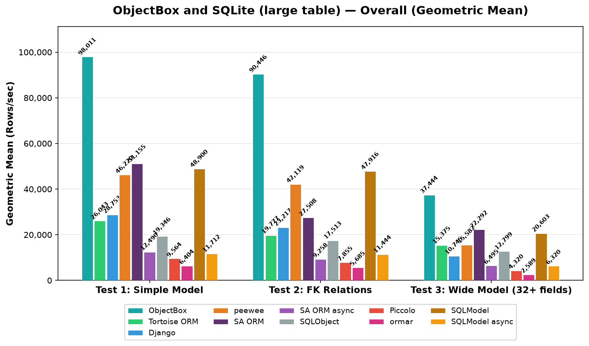
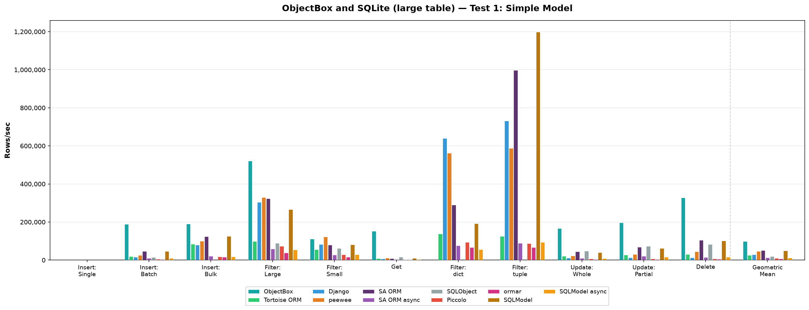
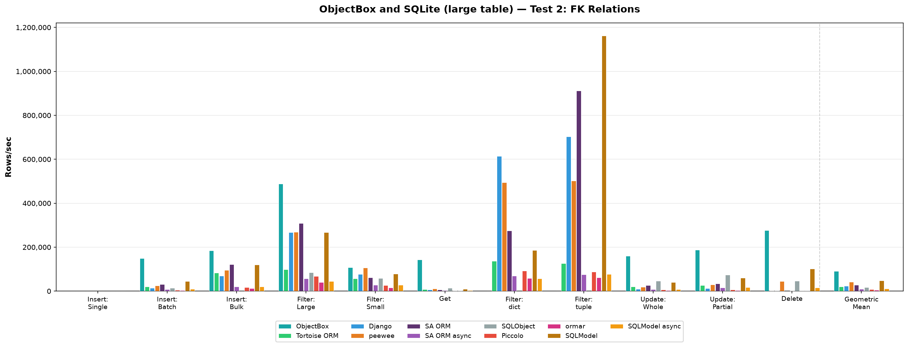
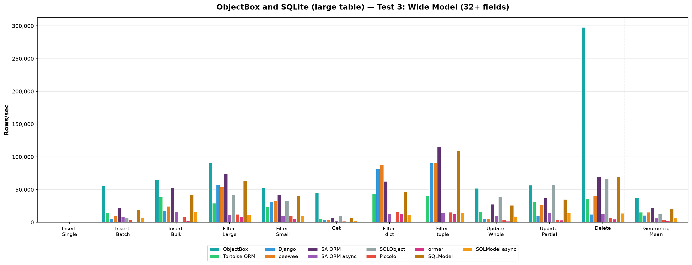
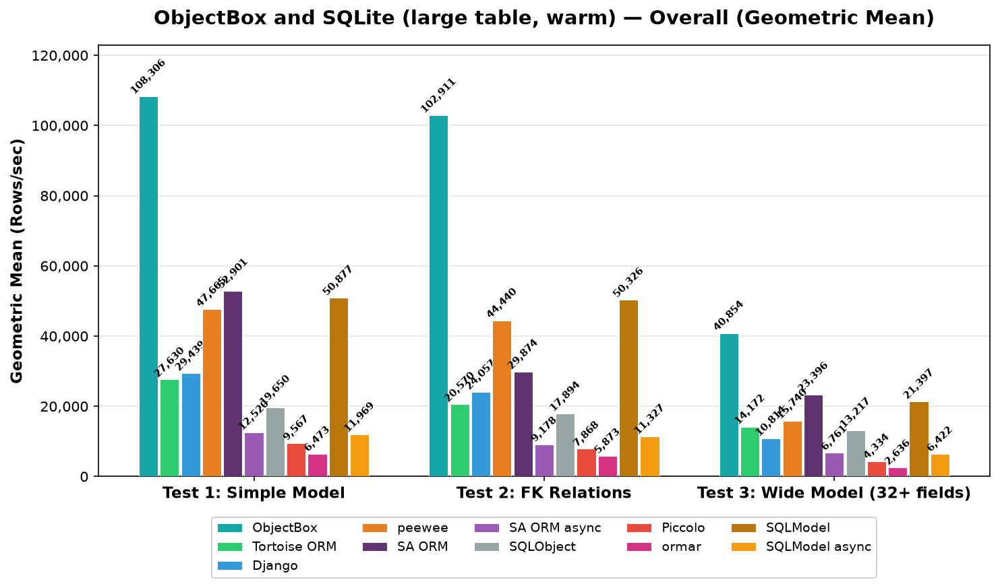
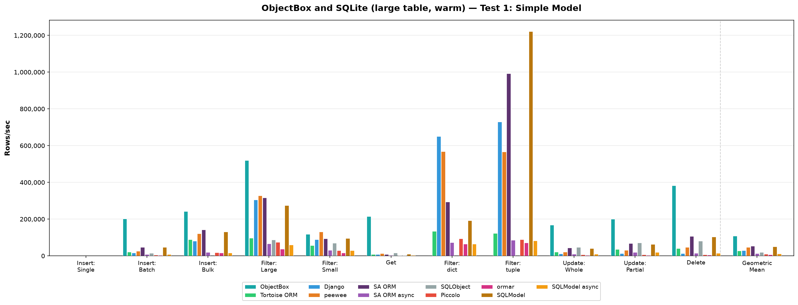
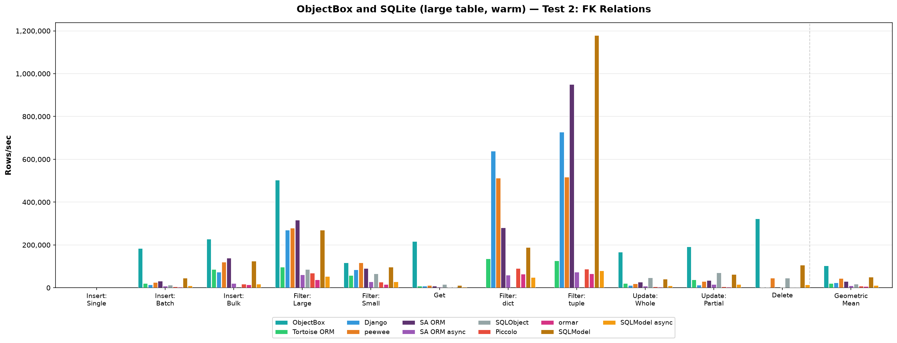
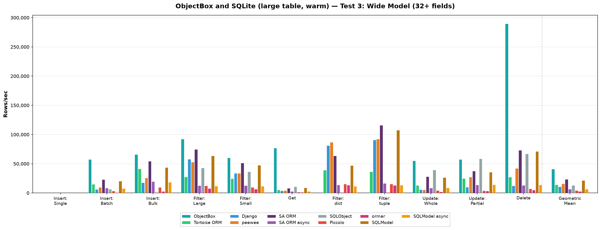

# Large table: ObjectBox and SQLite with ~20,000 rows

Detailed results of the large-table runs (`LARGE_TABLE=1`); summary, setup and the default results (~300 rows) are in the [README](README.md).

The only difference from the default runs: after Insert: Batch and Insert: Bulk (10,000 objects each), the untimed step that deletes the newest 9,900 rows again is skipped, so D–K run on ~20,100 rows instead of ~300. Filter: Large, Filter: dict and Filter: tuple return ~67x more rows per query; Filter: Small (20 rows) and Get (one row) fetch the same as before from a larger table; Update: Whole, Update: Partial and Delete update or delete all rows in one transaction each, so one durable commit is spread over ~20,100 rows instead of ~300. A–C don't depend on the table size (they run before it differs); their values here come from separate runs, so they differ slightly from the default results. Same machine, versions and settings (`ITERATIONS=100`, `BATCH_SIZE=10000`); each value is the median of 5 full runs ([raw results](raw-results/2026-10-18/)).

Tortoise ORM's Update: Whole, Update: Partial and Delete on Test 3 alternate between two levels from run to run, in cold and warm runs alike (e.g. Update: Whole ~13,200 or ~17,500 rows/sec), so their medians, and the cold/warm difference of its Test 3 geometric mean (×0.92), depend on which level the majority of the 5 runs hit.

## Cold

<!-- tables:sqlite_large -->
### Test 1: Simple Model (4 fields)

| Operation | Django | peewee | SA ORM | SA ORM async | SQLObject | Tortoise ORM | Piccolo | ormar | SQLModel | SQLModel async | ObjectBox | Best |
|-----------|--------|--------|--------|--------------|-----------|--------------|---------|-------|----------|----------------|-----------|------|
| Insert: Single | 54 | 160 | 54 | 49 | 54 | 159 | 49 | 49 | 53 | 49 | **245** | ObjectBox |
| Insert: Batch | 15,655 | 26,019 | 46,755 | 10,000 | 14,833 | 20,026 | 5,258 | 3,327 | 46,280 | 10,027 | **188,264** | ObjectBox |
| Insert: Bulk | 79,901 | 99,572 | 124,439 | 20,374 | — | 84,527 | 17,865 | 16,014 | 125,008 | 17,192 | **191,053** | ObjectBox |
| Filter: Large | 305,005 | 329,779 | 322,523 | 58,575 | 88,921 | 99,189 | 73,125 | 38,310 | 265,966 | 54,332 | **521,500** | ObjectBox |
| Filter: Small | 82,643 | **122,009** | 80,093 | 28,020 | 62,051 | 55,982 | 28,478 | 16,070 | 81,012 | 28,273 | 110,913 | peewee |
| Get | 7,327 | 12,126 | 8,605 | 3,736 | 15,523 | 8,428 | 2,479 | 1,541 | 9,726 | 3,654 | **152,299** | ObjectBox |
| Filter: dict | **640,041** | 562,356 | 289,302 | 76,568 | — | 137,684 | 93,376 | 67,634 | 192,290 | 56,387 | — | Django |
| Filter: tuple | 732,390 | 587,728 | 997,193 | 88,805 | — | 124,668 | 88,008 | 66,220 | **1,198,357** | 93,605 | — | SQLModel |
| Update: Whole | 11,077 | 21,867 | 44,227 | 9,440 | 47,369 | 21,225 | 6,639 | 3,369 | 40,268 | 9,051 | **167,257** | ObjectBox |
| Update: Partial | 12,742 | 30,911 | 67,911 | 20,353 | 72,875 | 27,020 | 6,805 | 4,003 | 62,355 | 16,223 | **196,449** | ObjectBox |
| Delete | 13,507 | 45,471 | 104,592 | 14,541 | 82,797 | 30,077 | 6,888 | 5,007 | 102,114 | 15,588 | **327,410** | ObjectBox |
| **Geometric Mean** | 28,753 | 46,220 | 51,155 | 12,490 | 19,346 | 26,043 | 9,564 | 6,404 | 48,900 | 11,712 | **98,011** | **ObjectBox** |

### Test 2: FK Relations

| Operation | Django | peewee | SA ORM | SA ORM async | SQLObject | Tortoise ORM | Piccolo | ormar | SQLModel | SQLModel async | ObjectBox | Best |
|-----------|--------|--------|--------|--------------|-----------|--------------|---------|-------|----------|----------------|-----------|------|
| Insert: Single | 54 | 160 | 53 | 49 | 54 | 160 | 49 | 48 | 53 | 49 | **236** | ObjectBox |
| Insert: Batch | 14,696 | 24,894 | 30,381 | 8,349 | 13,662 | 19,716 | 5,071 | 3,306 | 44,223 | 9,153 | **148,818** | ObjectBox |
| Insert: Bulk | 70,042 | 96,281 | 121,193 | 20,415 | — | 82,959 | 17,085 | 12,502 | 120,714 | 20,272 | **184,344** | ObjectBox |
| Filter: Large | 266,765 | 268,512 | 308,446 | 57,407 | 85,249 | 98,226 | 68,651 | 39,750 | 267,896 | 45,349 | **488,343** | ObjectBox |
| Filter: Small | 76,388 | 106,769 | 61,193 | 28,282 | 59,115 | 57,053 | 26,502 | 15,668 | 79,147 | 27,626 | **107,698** | ObjectBox |
| Get | 6,930 | 11,036 | 7,063 | 3,541 | 14,883 | 8,343 | 2,322 | 1,513 | 9,584 | 3,526 | **143,322** | ObjectBox |
| Filter: dict | **614,912** | 494,935 | 275,246 | 69,034 | — | 137,062 | 92,416 | 58,410 | 186,467 | 57,398 | — | Django |
| Filter: tuple | 703,103 | 501,898 | 912,370 | 75,978 | — | 126,857 | 88,177 | 61,852 | **1,161,820** | 76,561 | — | SQLModel |
| Update: Whole | 10,287 | 18,796 | 26,560 | 8,531 | 46,958 | 20,650 | 5,832 | 3,411 | 39,806 | 8,811 | **159,698** | ObjectBox |
| Update: Partial | 12,504 | 29,559 | 34,329 | 15,786 | 73,690 | 27,077 | 5,788 | 4,007 | 60,132 | 17,525 | **188,210** | ObjectBox |
| Delete | 2,424 | 44,159 | 1,143 | 1,272 | 46,300 | 1,522 | 1,434 | 2,169 | 101,760 | 16,302 | **276,134** | ObjectBox |
| **Geometric Mean** | 23,217 | 42,119 | 27,508 | 9,258 | 17,513 | 19,777 | 7,855 | 5,685 | 47,916 | 11,444 | **90,446** | **ObjectBox** |

### Test 3: Wide Model (32+ fields)

| Operation | Django | peewee | SA ORM | SA ORM async | SQLObject | Tortoise ORM | Piccolo | ormar | SQLModel | SQLModel async | ObjectBox | Best |
|-----------|--------|--------|--------|--------------|-----------|--------------|---------|-------|----------|----------------|-----------|------|
| Insert: Single | 53 | 158 | 53 | 49 | 54 | 159 | 49 | 44 | 53 | 49 | **210** | ObjectBox |
| Insert: Batch | 6,021 | 9,597 | 22,278 | 8,309 | 6,527 | 15,198 | 3,483 | 1,024 | 19,833 | 7,708 | **55,621** | ObjectBox |
| Insert: Bulk | 17,746 | 24,490 | 52,767 | 16,252 | — | 38,513 | 8,672 | 2,957 | 42,702 | 16,119 | **65,394** | ObjectBox |
| Filter: Large | 56,974 | 53,845 | 74,189 | 11,922 | 42,100 | 29,131 | 12,183 | 7,900 | 63,591 | 11,638 | **90,685** | ObjectBox |
| Filter: Small | 32,011 | 33,010 | 42,031 | 10,256 | 33,125 | 23,434 | 9,788 | 5,808 | 40,667 | 10,221 | **52,562** | ObjectBox |
| Get | 3,914 | 4,137 | 6,760 | 2,899 | 9,785 | 5,395 | 1,718 | 1,082 | 7,517 | 2,835 | **45,349** | ObjectBox |
| Filter: dict | 81,666 | **88,295** | 62,501 | 13,342 | — | 43,745 | 15,682 | 13,413 | 46,663 | 11,756 | — | peewee |
| Filter: tuple | 90,354 | 91,514 | **115,639** | 14,880 | — | 40,597 | 15,447 | 12,556 | 109,036 | 14,854 | — | SA ORM |
| Update: Whole | 5,954 | 5,474 | 27,545 | 9,809 | 39,140 | 16,394 | 4,156 | 1,839 | 26,108 | 9,089 | **51,895** | ObjectBox |
| Update: Partial | 10,099 | 26,701 | 36,894 | 14,628 | **57,789** | 31,563 | 4,434 | 3,415 | 35,156 | 14,443 | 56,683 | SQLObject |
| Delete | 12,199 | 40,734 | 69,947 | 13,104 | 66,613 | 35,969 | 7,188 | 5,008 | 69,600 | 13,744 | **297,729** | ObjectBox |
| **Geometric Mean** | 10,745 | 15,582 | 22,292 | 6,495 | 12,799 | 15,375 | 4,320 | 2,589 | 20,603 | 6,320 | **37,444** | **ObjectBox** |

<!-- /tables -->

## Warm

Each operation first runs once untimed in the same process, the database is restored, then the operation is timed (see the [README](README.md#detailed-results-warm)).

<!-- tables:sqlite_large_warm -->
### Test 1: Simple Model (4 fields)

| Operation | Django | peewee | SA ORM | SA ORM async | SQLObject | Tortoise ORM | Piccolo | ormar | SQLModel | SQLModel async | ObjectBox | Best |
|-----------|--------|--------|--------|--------------|-----------|--------------|---------|-------|----------|----------------|-----------|------|
| Insert: Single | 54 | 160 | 54 | 49 | 54 | 160 | 49 | 49 | 54 | 49 | **245** | ObjectBox |
| Insert: Batch | 16,037 | 26,273 | 46,599 | 9,135 | 14,499 | 20,762 | 5,094 | 3,325 | 47,804 | 9,160 | **202,502** | ObjectBox |
| Insert: Bulk | 81,825 | 120,648 | 142,247 | 20,417 | — | 88,457 | 17,864 | 17,288 | 130,401 | 17,202 | **241,543** | ObjectBox |
| Filter: Large | 304,867 | 328,208 | 316,873 | 66,379 | 88,127 | 97,817 | 75,114 | 37,345 | 274,713 | 59,426 | **519,198** | ObjectBox |
| Filter: Small | 89,762 | **131,640** | 93,961 | 30,917 | 69,947 | 57,648 | 28,949 | 16,483 | 95,223 | 28,643 | 118,812 | peewee |
| Get | 7,940 | 12,720 | 9,062 | 3,679 | 16,809 | 8,272 | 2,487 | 1,563 | 10,720 | 3,676 | **215,479** | ObjectBox |
| Filter: dict | **651,109** | 568,092 | 293,800 | 73,175 | — | 133,689 | 93,494 | 64,484 | 192,199 | 64,537 | — | Django |
| Filter: tuple | 728,893 | 567,109 | 992,201 | 85,538 | — | 123,452 | 89,148 | 70,670 | **1,221,146** | 82,878 | — | SQLModel |
| Update: Whole | 11,151 | 21,961 | 43,987 | 9,529 | 47,266 | 21,888 | 6,648 | 3,410 | 41,187 | 9,637 | **167,770** | ObjectBox |
| Update: Partial | 12,897 | 31,138 | 68,876 | 19,954 | 71,377 | 35,890 | 6,641 | 4,002 | 63,023 | 19,007 | **200,501** | ObjectBox |
| Delete | 13,592 | 46,946 | 107,129 | 14,509 | 81,274 | 40,207 | 6,959 | 5,011 | 102,970 | 15,387 | **383,008** | ObjectBox |
| **Geometric Mean** | 29,439 | 47,665 | 52,901 | 12,520 | 19,650 | 27,630 | 9,567 | 6,473 | 50,877 | 11,969 | **108,306** | **ObjectBox** |

### Test 2: FK Relations

| Operation | Django | peewee | SA ORM | SA ORM async | SQLObject | Tortoise ORM | Piccolo | ormar | SQLModel | SQLModel async | ObjectBox | Best |
|-----------|--------|--------|--------|--------------|-----------|--------------|---------|-------|----------|----------------|-----------|------|
| Insert: Single | 54 | 162 | 54 | 48 | 54 | 160 | 49 | 49 | 54 | 49 | **235** | ObjectBox |
| Insert: Batch | 14,873 | 25,587 | 31,664 | 8,449 | 13,535 | 20,558 | 5,076 | 3,306 | 45,950 | 9,361 | **184,316** | ObjectBox |
| Insert: Bulk | 73,400 | 120,097 | 138,199 | 20,439 | — | 86,484 | 17,082 | 13,907 | 125,441 | 16,889 | **227,378** | ObjectBox |
| Filter: Large | 270,115 | 279,242 | 315,794 | 61,140 | 86,765 | 97,095 | 69,287 | 38,351 | 270,053 | 54,017 | **502,569** | ObjectBox |
| Filter: Small | 84,802 | **117,851** | 89,985 | 28,973 | 65,701 | 58,295 | 26,710 | 16,711 | 96,211 | 29,062 | 116,609 | peewee |
| Get | 7,464 | 11,592 | 8,688 | 3,587 | 16,432 | 8,152 | 2,333 | 1,530 | 11,015 | 3,591 | **216,034** | ObjectBox |
| Filter: dict | **637,972** | 513,165 | 280,025 | 60,163 | — | 136,031 | 91,238 | 64,157 | 188,694 | 47,935 | — | Django |
| Filter: tuple | 727,280 | 517,866 | 949,600 | 72,800 | — | 126,569 | 88,229 | 66,528 | **1,178,786** | 80,418 | — | SQLModel |
| Update: Whole | 10,540 | 19,176 | 27,249 | 8,748 | 46,481 | 21,207 | 5,781 | 3,410 | 40,128 | 9,683 | **167,128** | ObjectBox |
| Update: Partial | 12,796 | 30,330 | 34,733 | 15,210 | 71,135 | 37,783 | 5,841 | 4,012 | 62,393 | 16,244 | **192,572** | ObjectBox |
| Delete | 2,474 | 45,477 | 1,158 | 1,260 | 46,291 | 1,541 | 1,444 | 2,242 | 105,864 | 14,965 | **322,492** | ObjectBox |
| **Geometric Mean** | 24,057 | 44,440 | 29,874 | 9,178 | 17,894 | 20,570 | 7,868 | 5,873 | 50,326 | 11,327 | **102,911** | **ObjectBox** |

### Test 3: Wide Model (32+ fields)

| Operation | Django | peewee | SA ORM | SA ORM async | SQLObject | Tortoise ORM | Piccolo | ormar | SQLModel | SQLModel async | ObjectBox | Best |
|-----------|--------|--------|--------|--------------|-----------|--------------|---------|-------|----------|----------------|-----------|------|
| Insert: Single | 54 | 160 | 54 | 49 | 54 | 161 | 49 | 46 | 54 | 49 | **213** | ObjectBox |
| Insert: Batch | 6,111 | 9,720 | 23,070 | 8,351 | 6,611 | 15,140 | 3,613 | 1,013 | 20,302 | 7,810 | **57,652** | ObjectBox |
| Insert: Bulk | 17,794 | 25,694 | 54,306 | 19,417 | — | 41,347 | 9,782 | 2,954 | 43,679 | 18,455 | **65,950** | ObjectBox |
| Filter: Large | 57,864 | 52,972 | 74,547 | 12,584 | 42,911 | 27,671 | 12,331 | 7,893 | 63,672 | 12,017 | **92,435** | ObjectBox |
| Filter: Small | 33,728 | 33,802 | 51,400 | 12,681 | 36,526 | 24,548 | 9,474 | 6,530 | 47,368 | 11,398 | **60,100** | ObjectBox |
| Get | 3,988 | 4,135 | 7,938 | 2,933 | 10,810 | 5,315 | 1,711 | 1,101 | 8,800 | 2,859 | **77,122** | ObjectBox |
| Filter: dict | 81,110 | **86,782** | 63,580 | 14,042 | — | 39,285 | 15,405 | 13,372 | 47,127 | 11,591 | — | peewee |
| Filter: tuple | 90,728 | 92,280 | **115,939** | 16,634 | — | 36,371 | 15,313 | 13,127 | 107,730 | 13,450 | — | SA ORM |
| Update: Whole | 5,745 | 5,408 | 27,849 | 8,655 | 39,368 | 13,231 | 4,245 | 1,821 | 26,358 | 9,059 | **55,036** | ObjectBox |
| Update: Partial | 10,143 | 27,250 | 37,466 | 13,956 | **58,496** | 24,871 | 4,090 | 3,413 | 35,724 | 14,166 | 57,397 | SQLObject |
| Delete | 12,162 | 42,110 | 73,049 | 12,956 | 67,007 | 27,159 | 7,200 | 5,011 | 71,316 | 13,932 | **289,596** | ObjectBox |
| **Geometric Mean** | 10,814 | 15,740 | 23,396 | 6,761 | 13,217 | 14,172 | 4,334 | 2,636 | 21,397 | 6,422 | **40,854** | **ObjectBox** |

<!-- /tables -->
